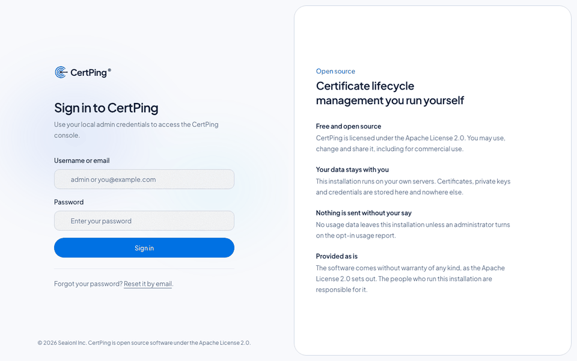

<div align="center">

<picture>
  <source media="(prefers-color-scheme: dark)" srcset="docs/assets/certping-logo-dark.png">
  
</picture>

<p>Find, renew and deploy TLS certificates across your clusters and clouds. Self-hosted, and your private keys stay in your network.</p>

<p>
  <a href="LICENSE"></a>
  <a href="https://github.com/certping-labs/certping/releases"></a>
  <a href="https://github.com/certping-labs/certping/actions/workflows/ci.yml"></a>
</p>

<p>
  <a href="#quickstart">Quickstart</a> ·
  <a href="#run-from-source">Run from source</a> ·
  <a href="#how-certping-compares">Compare</a> ·
  <a href="#documentation">Docs</a> ·
  <a href="#community-and-support">Community</a>
</p>

</div>

## What CertPing does

Certificates expire, and an expired certificate takes a site down. The deadline is real.
Certificates are capped at 200 days now, 100 days from March 2027, and 47 days from March 2029
([CA/B Forum](https://cabforum.org/2025/04/11/ballot-sc081v3-introduce-schedule-of-reducing-validity-and-data-reuse-periods/)).
Renewing by hand will not keep up.

CertPing keeps track of your TLS certificates, renews them before they expire, and helps you get
ready for post-quantum cryptography:

1. **Find** the certificates you already have in Kubernetes, AWS Certificate Manager and Azure
   Key Vault.
2. **Renew** them through Let's Encrypt, any other ACME CA, DigiCert or GlobalSign.
3. **Deploy** each new certificate to where it is used: Kubernetes, AWS, Azure, GCP, Cloudflare,
   Akamai or F5.
4. **Alert** you by email, Slack, Microsoft Teams, PagerDuty or ServiceNow when something needs
   attention.
5. **Plan for post-quantum cryptography.** The PQC readiness report checks the key and signature
   algorithm of every certificate against the NIST IR 8547 deadlines (deprecated after 2030,
   disallowed after 2035), flags certificates at risk of "harvest now, decrypt later", and exports
   your whole inventory as a CycloneDX CBOM (cryptographic bill of materials).

CertPing is not a certificate authority. You keep the CAs you use today, and CertPing manages
their certificates for you. Version 0.0.1-beta is a public beta.



## How it works

```text
 Browser ──► Web app ──► Server ◄──────── Agent ────────► CAs, DNS providers,
                           │      HTTPS, outbound only     clusters and clouds
                           ▼
                       PostgreSQL
```

- The **server** stores your certificates and decides what has to happen, for example "renew this
  certificate and deploy it to that cluster".
- The **agent** does the work. It talks to the CA, proves you own the domain with a DNS record and
  installs the certificate. It also creates and keeps the private keys.
- The agent only makes outgoing HTTPS calls to the server. Nothing connects in to it, so an agent
  can run behind a firewall, next to the systems it manages.
- Every install comes with one agent. Add more agents for other networks or clusters.

[Architecture](docs/architecture.md) has the full picture.

## Quickstart

Start with the all-in-one image. It runs the web app, server, agent, notifier, PostgreSQL,
Valkey and Caddy in one container. You need Docker and about 4 GB of free memory.

```sh
docker run -d --name certping \
  -p 80:80 -p 443:443 \
  -v certping:/var/lib/certping \
  -e CERTPING_URL=http://localhost \
  ghcr.io/certping-labs/certping:0.0.1-beta
```

The first start takes 2 to 4 minutes. Then print your sign-in details:

```sh
docker exec certping certping-admin
```

Open http://localhost, sign in as `admin` with the password it printed, and choose a new password.

To issue and renew a test certificate, follow [Getting started](docs/getting-started.md). The
tutorial creates its own container and volume so you can keep your Quickstart installation.

## Try it without a domain or a cluster

The end-to-end lab runs CertPing on your machine with its own test CA, DNS server, Kubernetes
cluster and mailbox. It issues, deploys, discovers and renews certificates for real, and checks
every step:

```sh
make images            # build the images from this checkout
deploy/e2e-lab/run.sh  # start the lab and run the checks
```

It needs Docker, Python 3 and about 4 GB of free memory. See [deploy/e2e-lab](deploy/e2e-lab/README.md).

## Run from source

You need Docker with Compose v2, plus Python 3 and OpenSSL for the setup script.

```sh
git clone https://github.com/certping-labs/certping.git
cd certping
make up
```

`make up` builds every image from your checkout and starts CertPing with Docker Compose on
http://localhost. The first time, it creates `deploy/compose/.env` with fresh secrets. Your first
admin password is in that file:

```sh
grep '^BOOTSTRAP_SUPER_ADMIN_PASSWORD=' deploy/compose/.env
```

When the server is ready (a minute or two), open http://localhost and sign in as `admin` with that
password. Copy it without the single quotes around it. CertPing then asks you to choose a new
password.

Run `make up` again after you change code, and `make down` to stop. Your data is kept.

To work on the code you also need Java 25, Maven, Node.js 24 and pnpm
([versions](CONTRIBUTING.md#prerequisites)). Useful commands:

```sh
make help      # list every command
make ci        # lint, test and build everything, the same checks as CI
make web-dev   # web app with hot reload on http://localhost:3000, next to make up
```

The hot-reload setup needs a small `apps/web/.env.local` file; see
[Web app with hot reload](CONTRIBUTING.md#web-app-with-hot-reload).

[CONTRIBUTING.md](CONTRIBUTING.md) explains the code, the tests and how to send a change.

## Repository layout

| Folder | What is in it |
| --- | --- |
| [`apps/web`](apps/web/README.md) | Web app (Next.js, TypeScript) |
| [`apps/server`](apps/server/README.md) | API, scheduler and job queue (Java, Spring Boot, PostgreSQL) |
| [`apps/agent`](apps/agent/README.md) | Agent: CAs, DNS providers, deployment targets, discovery (Java) |
| [`apps/notifier`](apps/notifier/README.md) | Sends email (Java) |
| [`deploy`](deploy) | Install kits: all-in-one container, Docker Compose, Helm charts, Azure VM, end-to-end lab |
| [`docs`](docs) | Documentation |

## Install options

| Option | Best for | What to use |
| --- | --- | --- |
| All-in-one container | A trial, a homelab or a small team on one host | The image in [Quickstart](#quickstart) |
| Docker Compose | One server with separate service containers | `certping-compose-<version>.zip` from [Releases](https://github.com/certping-labs/certping/releases) |
| Helm | Kubernetes | The `certping` chart in [the Helm install guide](deploy/charts/certping/README.md) |
| Extra agent | A second cluster or network | The [agent install guide](docs/agents.md) |
| Azure single VM | An Azure subscription without a cluster | The [Azure VM guide](deploy/azure/single-vm/README.md) |

Use a version tag such as `0.0.1-beta`. [Release assets](docs/release-assets.md) explains the
downloads, image references and corresponding source bundles.

## Good to know

- **Beta:** expect breaking changes before version 1.0.0. Integrations marked beta in
  [Integrations](docs/integrations.md) are tested only against mocked APIs.
- **DNS validation only:** to renew a name on its own, CertPing needs API access to that name's
  DNS zone.
- **Discovery reads certificate stores.** It does not scan your endpoints.
- **PQC readiness is a planning tool.** It classifies the certificates you have; it does not issue
  post-quantum certificates or test your endpoints' TLS key exchange.
- **The bundled agent shares storage with the server,** so the server host can read the keys it
  holds. Run a separate agent to keep keys away from the server
  ([key custody](docs/architecture.md#key-custody-and-trust)).

More in [SECURITY.md](SECURITY.md#known-limitations).

## How CertPing compares

CertPing is for teams whose certificates are spread across clusters, clouds, CDNs and appliances,
and who want one self-hosted place to find, renew and deploy them.

| | CertPing | cert-manager | Certbot, acme.sh, lego | Caddy | Commercial CLM platforms |
| --- | --- | --- | --- | --- | --- |
| What it is | Self-hosted certificate lifecycle manager | Kubernetes controller | Command-line ACME clients | Web server with automatic HTTPS | Enterprise certificate lifecycle products |
| Where it works | Many clusters, clouds and networks, through agents | One Kubernetes cluster per install | One host per install | The sites that Caddy itself serves | Many environments |
| Web UI and central inventory | Yes | No (Kubernetes resources) | No | No | Yes |
| Finds certificates you already have | Kubernetes, AWS ACM, Azure Key Vault | No | No | No | Yes, usually including network scans |
| Certificate authorities | Any ACME CA, DigiCert, GlobalSign | ACME, Vault, its own CA and others through issuers | ACME | ACME and its own internal CA | Many |
| Deploys to cloud load balancers, CDNs and appliances | Yes: AWS, Azure, GCP, Cloudflare, Akamai, F5, Kubernetes | No, Kubernetes Secrets only | Local files; scripts or deploy hooks for more | Its own server only | Yes |
| Private keys stay in your network | Yes, agents keep them | Yes, in the cluster | Yes, on the host | Yes, on the server | Depends on the product and where it runs |
| Post-quantum readiness and CBOM export | Yes | No | No | No | Varies |
| License and cost | Apache 2.0, free | Apache 2.0, free | Free and open source | Apache 2.0, free | Paid, closed source |
| Maturity | Public beta | Mature, widely used | Mature, widely used | Mature, widely used | Mature |

When something else is the better choice:

- **A few servers or a homelab:** Certbot, acme.sh or lego on each host, or Caddy as your web
  server, is simpler than running CertPing.
- **Everything runs in one Kubernetes cluster:** use cert-manager. CertPing adds value once you also
  have certificates in cloud load balancers, CDNs, appliances or other clusters.
- **You need broad network scanning, many more CAs and vendor support today:** a commercial
  certificate lifecycle platform covers more, at a price. CertPing offers paid support and
  enterprise plans through [certping.com/enterprise](https://www.certping.com/enterprise/).

## Documentation

| Guide | Read it to |
| --- | --- |
| [Getting started](docs/getting-started.md) | Issue, deploy and renew your first certificate |
| [Self-hosting](docs/self-hosting.md) | Choose an install, protect its secrets, set up sign-in, review privacy |
| [Configuration](docs/configuration.md) | Look up any setting |
| [Integrations](docs/integrations.md) | See every CA, DNS provider and deployment target, and the permissions each needs |
| [Agents](docs/agents.md) | Run agents in other networks and clusters |
| [Operations](docs/operations.md) | Upgrade, back up, monitor and troubleshoot |
| [Architecture](docs/architecture.md) | Understand how the parts work and where keys live |
| [PQC readiness](docs/architecture.md#pqc-readiness) | See how certificates are classified for post-quantum migration and how to export a CBOM |
| [Release assets](docs/release-assets.md) | Choose an install download and find source, scans and checksums |
| [Release notes](https://github.com/certping-labs/certping/releases) | See what changed in each version |

## Community and support

- Questions and ideas: [GitHub Discussions](https://github.com/certping-labs/certping/discussions)
- Bugs and feature requests: [GitHub issues](https://github.com/certping-labs/certping/issues)
- Private help: `support@certping.com`
- Paid support, enterprise plans and managed cloud:
  [certping.com/enterprise](https://www.certping.com/enterprise/) or `sales@certping.com`

## Security

Report vulnerabilities privately to `security@certping.com` or through GitHub private
vulnerability reporting. See [SECURITY.md](SECURITY.md).

## Contributing

Contributions are welcome; start with [CONTRIBUTING.md](CONTRIBUTING.md). Each commit needs a
`Signed-off-by` line (`git commit -s`), and the [code of conduct](CODE_OF_CONDUCT.md) applies.

## License

CertPing's source code is licensed under the [Apache License 2.0](LICENSE). Copyright Seaionl Inc.
and CertPing contributors. Bundled third-party software keeps its own licenses. See [NOTICE](NOTICE)
and [the licenses shipped in the images](licenses/README.md). CertPing® is a registered trademark
of Seaionl Inc. ([TRADEMARKS.md](TRADEMARKS.md)).

The hosted service at certping.com and Seaionl's paid offerings are covered by the
[CertPing terms](https://www.certping.com/terms/) and
[privacy policy](https://www.certping.com/privacy-policy/). The code in this repository is
licensed under Apache 2.0 and is not bound by those terms. What a self-hosted install sends out
of your network is described in [docs/self-hosting.md](docs/self-hosting.md#privacy-and-telemetry).

CertPing is built by the CertPing team at Seaionl Inc. Created by Chennarao Vemula, project lead
and lead architect ([@chenna-certping](https://github.com/chenna-certping), personal
[@cvemula1](https://github.com/cvemula1), chenna@certping.com), with Sameera Khatoon, Izaan Anwar
and the rest of the team; see [AUTHORS.md](AUTHORS.md) and [MAINTAINERS.md](MAINTAINERS.md).
