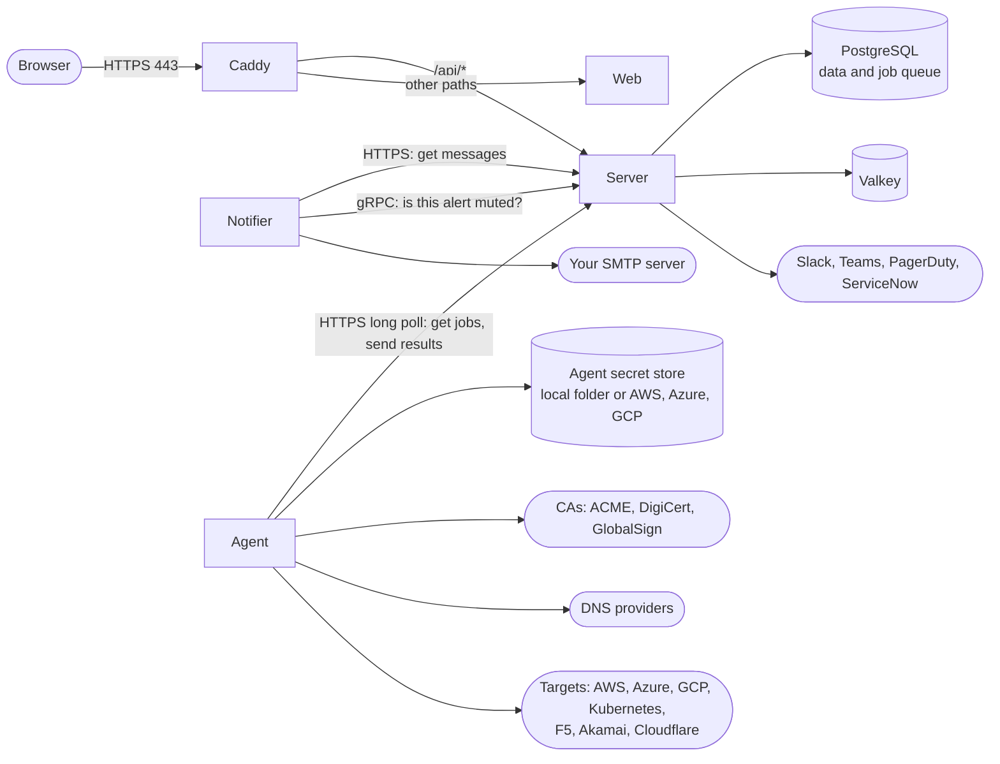
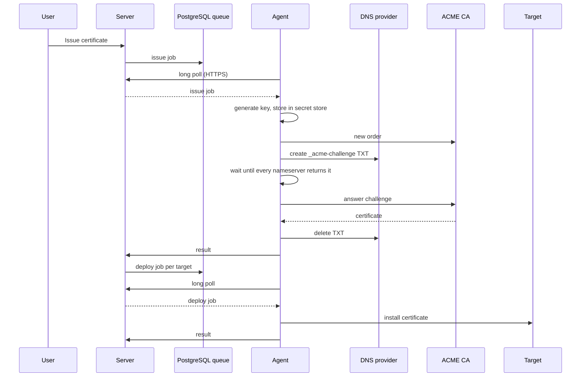

# Architecture

One rule shapes the rest of CertPing's design: nothing connects into an agent. The server keeps
the records and decides what should happen. Agents do every job that reaches outside (CAs, DNS,
clouds, clusters) and keep the private keys. Agents only make outgoing HTTPS calls to the server,
so they work behind firewalls, and the keys stay in the agent's secret store. This page explains
the pieces, how they connect, and what that design costs. The ideas behind organizations, agents
and credentials are in [Concepts](#concepts).

## The pieces

| Piece | Folder | What it does | Listens on |
| --- | --- | --- | --- |
| Web | `apps/web` | The screens. No data of its own | 3000 (internal) |
| Server | `apps/server` | API, sign-in, certificate records, scheduler, job queue, agent gateway, audit log, PQC readiness | 8080 (internal), gRPC 50051 (internal) |
| Agent | `apps/agent` | CA and ACME orders, DNS challenges, deployments, discovery scans. Generates and stores private keys | Nothing |
| Notifier | `apps/notifier` | Email delivery, with retries. Slack, Teams, PagerDuty and ServiceNow are called by the server | Nothing |
| PostgreSQL | | All data, including the job queue | 5432 (internal) |
| Valkey (Redis compatible) | | Signed-out tokens and short caches. Password required. CertPing keeps working if it is down | 6379 (internal) |
| Caddy | `deploy/all-in-one` | HTTPS front door; sends `/api/*` to the server and everything else to the web app | 80, 443 |

## How they connect



| From | To | How | Why |
| --- | --- | --- | --- |
| Browser | Caddy | HTTPS 443 | Use the app |
| Caddy | Web, Server | HTTP inside the install | Routing |
| Server | PostgreSQL | 5432 | Data and the job queue |
| Server | Valkey | 6379 with a password | Token sign-out list, caches |
| Agent | Server agent gateway | HTTPS with an agent token; each poll asks to wait 20 seconds for work, and the server caps a poll at 25 seconds | Get jobs, return results |
| Notifier | Server agent gateway | HTTPS with the internal token | Get messages to deliver |
| Notifier | Server | gRPC 50051 with the internal token, internal network only | Check whether an organization muted an alert |
| Server | Notifier HTTP API | HTTP 8080 with the internal token, internal network only | Hand over notifications, list sent ones |
| Agent | CAs, DNS, clouds, clusters | HTTPS (Kubernetes API on 6443) | The certificate work |
| Server | Slack, Teams, PagerDuty, ServiceNow | HTTPS | Only for the integrations an organization adds |
| Server | Your OpenID Connect provider | HTTPS | Only when single sign-on is set up |
| Server | CertPing project | HTTPS | Only when the opt-in usage report is on |

## The job queue

Work between the server and agents goes through the `message_queue` table in PostgreSQL. There is
no separate queue server, and this is the only transport.

The server writes one row per job: issue, renew, deploy, discover. An agent takes the next job
with `FOR UPDATE SKIP LOCKED`, so many agents and server replicas can pull at once and each job
goes to exactly one of them. While an agent works it renews its hold on the job, for up to 30
minutes, so a slow DNS check never makes a second agent start the same job. Finished jobs are
deleted. A job that fails 10 times is set aside as dead and kept 14 days for inspection, and
sending the same job twice is ignored. A new job reaches a waiting agent in about half a second,
and each agent runs 8 jobs at once by default (`CERTPING_AGENT_MAX_CONCURRENT_JOBS`).

Using the database the server already needs means a complete installation is one server, one
PostgreSQL, one Valkey and any number of agents. There is no broker to install, secure, back up or
upgrade, and a job is in the same backup as the certificate it belongs to. The price is in
throughput and delivery semantics. Throughput is limited by PostgreSQL and by how many long polls the server can hold, and
idle agents are not free: in the lab load test each idle agent caused about 0.8 database queries a
second. The design target is thousands of agents, not tens of thousands. Delivery is at least once,
so every job handler has to be idempotent.

Long-polled HTTPS asks nothing of the network between an agent and the server beyond ordinary
HTTPS and proxies that allow a 60-second read timeout. A gRPC or WebSocket stream could replace it
later without changing the queue.

How a failed job is retried depends on the failure. A permanent failure (a rejected credential, bad
input, a CA's `INVALID` verdict) would fail the same way again, so the job is set aside at once and
reported. A retryable failure carries a time from the provider, such as an ACME `Retry-After` or a
`429`, and the job is rescheduled for then. A transient failure (a network error, a `5xx`) is
retried on a backoff from 30 seconds up to 24 hours. Every failure carries a code such as
`DNS_PROPAGATION_TIMEOUT`; [operations.md](operations.md#troubleshooting) lists the common ones.

## Internal gRPC

The server serves one internal gRPC service, `certping.internal.v1.NotificationPolicyService`. The
notifier calls it before it emails an organization, to ask whether that organization turned the
notification off. The contract is
`apps/server/src/main/proto/certping/internal/v1/notification_policy.proto`; the notifier keeps an
unedited copy.

The port is `50051` (`INTERNAL_GRPC_PORT`), and `INTERNAL_GRPC_ENABLED=false` turns it off. The
notifier finds it through `CERT_MANAGER_GRPC_ADDR` (table below).

Every call must carry the internal token (`CERTPING_INTERNAL_TOKEN`) as the metadata
`authorization: Bearer <token>`. Health checks and reflection included, a call without it is
closed with `UNAUTHENTICATED`, and with no token configured every call is refused.

The port opens only on `INTERNAL_GRPC_BIND_ADDRESS`, never on every interface by default:

| Install | Bind address | Notifier dials |
| --- | --- | --- |
| All-in-one | `127.0.0.1` (the default) | `127.0.0.1:50051` |
| Compose | `server-grpc`, the server's alias on the internal `notifier` network | `server-grpc:50051` |
| Helm | The pod IP, plus a NetworkPolicy that admits only the notifier | `<release>-server-grpc:50051` |

Keep `networkPolicy.enabled: true` in Helm, use a CNI that enforces NetworkPolicies, and never
expose this port.

Plaintext gRPC is used on that internal network; the token is not encrypted in transit. Reflection
is on, so `grpcurl` needs no `.proto` file. From inside the installation's network (in Compose, a
container on the `notifier` network):

```bash
grpcurl -plaintext -max-time 5 -H "authorization: Bearer $CERTPING_INTERNAL_TOKEN" \
  server-grpc:50051 list
grpcurl -plaintext -max-time 5 -H "authorization: Bearer $CERTPING_INTERNAL_TOKEN" \
  server-grpc:50051 grpc.health.v1.Health/Check
```

In the all-in-one image use `127.0.0.1:50051` instead of `server-grpc:50051`.

### Notifier HTTP API

Every HTTP endpoint of the notifier requires the same internal token, as
`Authorization: Bearer <token>`, compared in constant time. The only exception is
`/actuator/health` and its groups, which return UP or DOWN and nothing else, so container and
Kubernetes probes work without a secret. A request without the token gets `401`. With no token
configured, the notifier answers nothing but health.

### Compose networks

The Compose kit splits its containers into four networks, so each one reaches only the peers it
needs:

| Network | Internal | Members | Purpose |
| --- | --- | --- | --- |
| `edge` | No | proxy, web, server, agent | Published ports, and internet access for the server and the agent |
| `notifier` | Yes | server, notifier | The notifier's HTTP API and the server's gRPC port. Web, the proxy and the agent cannot reach either |
| `data` | Yes | PostgreSQL, Valkey, server, notifier | Databases, unreachable from web, the proxy and the agent |
| `mail` | No | notifier, mailpit | The notifier's way out to your SMTP server |

## Issuing a certificate

When a user asks for a certificate, the server saves the request and queues an issue job. A
waiting agent takes it, generates the private key and stores it in its own secret store; the
database keeps only a reference. The agent then orders the certificate. For DNS validation it
writes the TXT record through the DNS provider, waits until every nameserver of the zone returns
it, lets the CA check it and removes the record. It returns the certificate, and the server
records it and queues one deploy job per target. The agent installs the certificate on each
target and reports back, and the server queues a notification for the notifier to deliver.



Waiting for every authoritative nameserver, rather than for one public resolver, is slower but
avoids the most common DNS-01 failure: the CA asks a nameserver that has not received the record
yet and the order fails.

Renewal is the same flow, started by the scheduler instead of a user. Each night it queues a
renewal for every certificate that is due, and the new certificate replaces the old one on every
target. A retry run every 5 minutes picks up failures, and the daily expiry alerts warn about
anything that is still close to expiry.

Discovery uses the same queue. A scan becomes a discover job for one scope, such as a Kubernetes
cluster, an AWS region or an AWS Organization. The agent reads the certificate store, read-only,
and returns results in batches, with a list of any parts of the scope it could not read. The
server matches the results against the certificates CertPing manages and updates the inventory,
and leaves the rows of the failed parts as they were. Discovery does not connect to endpoints.

## Where it runs

| Install | Layout | For |
| --- | --- | --- |
| One container (`deploy/all-in-one`) | Everything, including PostgreSQL, Valkey and one agent, in one container | Trying CertPing, small teams |
| Docker Compose (`deploy/compose`) | One container per piece on one machine; PostgreSQL can be external | Small and mid-sized teams |
| Helm (`deploy/charts`) | Separate deployments, several server replicas, a managed highly available PostgreSQL | Larger installs |

Any install can add agents elsewhere, for example one per AWS network or one inside each
Kubernetes cluster. Each connects back over HTTPS with its own token.

## Where secrets live

Certificate private keys are generated by the agent and kept in its secret store: an encrypted
local folder by default, or AWS Secrets Manager, Azure Key Vault or Google Secret Manager. The
server keeps only a reference. Provider credentials (DNS, cloud, CA) are either a reference to
your own secret store, or typed in once, passed through the server and written to the agent's
secret store. Changes to `apps/agent/src/main/java/com/certping/agent/secrets` get extra review
(see `.github/CODEOWNERS`).

Keeping keys at the agent means a compromised server database does not hand out private keys. It
also means the agent's store is the one thing you cannot lose: with the default `LOCAL` store,
the secrets directory and `CERTPING_LOCAL_SECRET_KEY` are as important to back up as the database
([operations.md](operations.md#back-up-and-restore)).

## Build and test

| App | Build tool | CI job |
| --- | --- | --- |
| web | pnpm (version pinned in `package.json`) | `Web` |
| server, agent, notifier | Maven, JDK 25 | `java (server/agent/notifier)` |
| Helm charts | Helm | `Helm charts` |
| Everything together | `deploy/e2e-lab/run.sh` | end-to-end lab |

`make help` lists the commands, and CI runs the same `make` targets.

## Key custody and trust

This page says where private keys are created and kept, which processes can read them, and how
far an agent token is trusted. Read it before you choose an install layout for certificates whose
keys matter.

Short version: private keys are generated by the agent and stored in the agent's secret store
inside infrastructure you run. In the all-in-one and Compose installs, the server process can also
read them. Use a separate agent for stronger isolation.

### Where keys are generated

The agent generates every private key, on the machine or pod where it runs, when it builds the
certificate signing request. The server never generates a key and never receives one in a job
result. ACME and DigiCert orders use RSA 2048.

### Where keys are staged and stored

The agent keeps keys in its secret store, chosen with `AGENT_SECRET_STORE_PROVIDER`
([agents.md](agents.md#choose-a-secret-store)):

| Store | Value | Where the key ends up |
| --- | --- | --- |
| Local encrypted files | `LOCAL` | AES-256-GCM encrypted files, mode 0660, in `CERTPING_LOCAL_SECRET_DIR` (default `/var/lib/certping/secrets`), encrypted with `CERTPING_LOCAL_SECRET_KEY` |
| AWS Secrets Manager | `AWS_SECRETS_MANAGER` | Your AWS account, secrets named `certping/*` |
| Azure Key Vault | `AZURE_KV` | Your vault |
| Google Secret Manager | `GCP_SECRET_MANAGER` | Your Google Cloud project |

During an order the agent first writes the key and the CSR to a staging slot in the same store
(`<reference>-key-staging`). After issuance it stores the certificate chain and the key together
under one handle and removes the staging slot. Removal is best effort in 0.0.1-beta: a crash in the
middle of an order can leave a staging slot behind, in plaintext inside the store. There is no
sweeper for old slots yet.

The database stores only the handle, never the key.

### When the server can read a key

The server reads a private key in one case: the export feature. When a user with
`certificate:deploy` downloads a format that includes the key (PEM with key, or PKCS#12), the
server reads the bundle through the agent store and serves it. The download is rate-limited and
audited. For the duration of the request the server holds the plaintext key in memory.

Whether the server can reach the store depends on the install:

| Install | Can the server host read keys? | Why |
| --- | --- | --- |
| All-in-one container | Yes | The server and the bundled agent share one `LOCAL` store, the same `CERTPING_LOCAL_SECRET_KEY`, the same volume and the same user ID. |
| Docker Compose | Yes | Same as above: the server and the bundled agent mount the same secrets volume and get the same key from `.env`. |
| Helm `certping` chart with the bundled agent | Yes, for the bundled agent's store | The bundled agent runs in the server pod and mounts the same `*-agent-secrets` volume, with the same `CERTPING_LOCAL_SECRET_KEY` from the `certping` Secret. |
| A separate agent with its own cloud secret manager | No, unless you use export | The server has no credentials for that secret manager and no copy of a local key. |

So on a single-box install, the server can read every key the bundled agent holds, and anyone with root on the host, or with access to the container, the
secrets volume and `.env`, can decrypt every key. Treat that host like a key store.

#### How to keep keys away from the server

For certificates whose keys must not be readable from the server host:

1. Run a separate agent in the target network, with its own token
   ([agents.md](agents.md#create-an-agent-token)).
2. Give that agent its own cloud secret manager (AWS Secrets Manager, Azure Key Vault or Google
   Secret Manager), not `LOCAL`. The `certping-agent` chart refuses `LOCAL`.
3. Put those certificates in an organization served only by that agent, so the bundled agent
   never takes their jobs (see [agent tokens](#trust-model-of-agent-tokens) below). Set
   `CERTPING_BOOTSTRAP_AGENT_ORG` or `bootstrapAgentOrganization` so the bundled agent works for
   a different organization, or turn it off in Helm with `bundledAgent.enabled: false`.
4. Do not use export for those certificates. Export is the one path through which the server
   reads a key.
5. Create their credentials with **Agent identity or my own vault**, not **Paste the
   credential**, because pasted credentials are written to the server's own store
   ([Credentials](#credentials)).

Planned: a separate user ID and key for the bundled agent on single-box installs, and export
through the agent, encrypted to the requester and off by default per organization.

### What never contains private keys

- Logs. The server and agent log the store handle path, never the key.
- The opt-in usage report. It holds counts and versions only ([Privacy and telemetry](self-hosting.md#privacy-and-telemetry)).
- Inventory and certificate APIs. They return certificates, metadata and handles. The only API
  that returns a key is the audited export download.
- The database. It holds handles, credential references and token hashes.
- The audit log. Key material and credential values are never written to it.
- Job messages between server and agent. Issuance results carry the handle, not the key.

### Trust model of agent tokens

An agent token is trusted for its whole organization. In 0.0.1-beta:

- Every agent of an organization takes jobs from one queue, and any agent may receive any job of
  that organization. Jobs carry credential handles for DNS providers, CAs and deployment
  targets, so every agent in the organization sees those handles.
- Any agent of an organization can post a result for any job of that organization.
- So a leaked token of a lab agent gives its holder the jobs and credential handles of every
  production certificate in the same organization.

What to do:

- Use one organization per trust zone. Do not put a lab agent and a production agent in the same
  organization.
- Do not share one agent between organizations that should not reach each other's systems.
- Give a token an expiry when you create it (**Expires after** on the **Agents** card, or
  `expiresInDays` from 1 to 3650 in the API). Without one it never expires. The bundled agent's
  bootstrap token never expires.
- Revoke a token you no longer use, or suspect is exposed, on the **Agents** card. An expired or
  revoked token gets `401` on its next call ([agents.md](agents.md#revoke-a-token)).
- Each applied result is recorded with the token that delivered it (table
  `agent_result_receipts`), so after a token leak you can tell which results it sent.

Planned for a later release: per-agent identity, jobs addressed to one agent, results accepted only
from that agent, and mTLS.

### Kubernetes: scope to the namespaces you need

Kubernetes discovery across all namespaces needs cluster-wide read on TLS Secrets, which also
gives the agent's identity read access to the private keys in them. Scope the discovery
credential to the namespaces you need, with namespace-scoped `Role` objects
([Scope](integrations.md#scope)).

For deployment, the all namespaces option writes the private key into every namespace of the
cluster, including `kube-system`. Use a list of named namespaces instead
([Kubernetes secrets](integrations.md#3-kubernetes-secrets)).

The Kubernetes deploy also replaces a Secret of the same name, even one that another tool such as
cert-manager manages. Do not point a CertPing target at a Secret that something else owns.

### First-run setup

When the `BOOTSTRAP_SUPER_ADMIN_*` values are empty, the web app sends the first visitor to a
setup screen to create the Platform Super Admin. There is no setup token in 0.0.1-beta: whoever reaches
the URL first becomes the admin. The all-in-one image, the Compose `setup.sh` and the Helm
chart's `create-secret.sh` set the bootstrap values for you. If you install another way, set them
yourself, or keep the URL unreachable from untrusted networks until setup is done
([self-hosting.md](self-hosting.md#first-start)).

### Related pages

- [self-hosting.md](self-hosting.md#protect-the-secrets-of-the-installation): which files are as
  sensitive as the keys.
- [agents.md](agents.md): running agents in other networks.
- [architecture.md](architecture.md): how the processes connect.
- [SECURITY.md](../SECURITY.md#known-limitations): known security limitations.

## Concepts

This page explains the ideas CertPing is built on and why they work the way they do. Steps are in
[getting-started.md](getting-started.md) and [operations.md](operations.md); settings are in
[configuration.md](configuration.md). How the processes talk to each other is in
[architecture.md](architecture.md).

### Organizations

An organization is the unit everything belongs to: certificates, credentials, deployment targets,
agents, members, alerts and the audit trail. Data never crosses organizations.

A new installation creates one organization for the first admin, named "My organization" unless
`CERTPING_ORGANIZATION_NAME` says otherwise. A Platform Super Admin can add more under
**Organization & Access**, tab **Organization**, and switch with **Work in this organization**.

The obvious reason to create a second organization is a team or customer that must not see
another's certificates. The less obvious reason is networks. Every agent belongs to one
organization and takes jobs from that organization's queue, so the organization is also the
boundary of where work can run (see [agents](#agents)). Two networks that cannot reach each other
need two organizations in 0.0.1-beta.

### Users and roles

People sign in with a local account (username or email and a password, with optional TOTP) or
through the one OpenID Connect provider an operator configured
([self-hosting.md](self-hosting.md#single-sign-on-openid-connect)). There is one provider per
installation rather than one per organization, which keeps the setup to a few environment
variables but means every organization shares it.

A role is a named set of permissions such as `certificate:issue`, `credential:create` or
`audit:view`. There are four built-in roles:

| Role | Name in the API | What it may do |
| --- | --- | --- |
| Platform Super Admin | `SUPER_ADMIN` | Administers the installation: creates, suspends and manages organizations, platform settings and the platform-wide audit log. |
| Organization Admin | `ORGANIZATION_ADMIN` | Manages one organization: members and roles, discovery, rotation, deployments, credentials and its audit log. |
| Security Analyst | `SECURITY_ANALYST` | Sees the inventory, discovery, PQC readiness, rotation and deployments; runs what an admin configured; acknowledges alerts. Cannot manage members, credentials or integrations. |
| Viewer | `VIEWER` | Read-only access to certificates, discovery, PQC readiness, rotation, deployments and audit information. |

The first admin is both Platform Super Admin and Organization Admin of the first organization.
Members and roles are managed under **Organization & Access**, tab **Members & roles**.

### Agents

An agent is the process that does every job that reaches outside CertPing: ACME orders, DNS
records, deployments and discovery scans. It generates the private keys and keeps them in its
secret store.

The agent connects to the server, never the other way round. It long-polls the agent gateway
(`/api/v1/agent-gateway`) over outbound HTTPS, so it can run behind NAT or a firewall that allows
nothing inbound, in a VPC, a data center or a customer site. The same split limits what the
server touches: it holds records and decides what should happen, but it never calls your CAs, DNS
providers, clusters or cloud accounts, and it does not keep the private keys. It reads a key from
the agent's store only when a user with `certificate:deploy` downloads a format that includes
the key, and that download is rate-limited and audited. On the single-server kits the server and
the bundled agent share one key store, so the server host can read the keys; a separate agent
with its own cloud secret manager avoids that ([Key custody and trust](#key-custody-and-trust)). The cost of the
split is one more process to run in each network, and work only moves when an agent asks for
it. A waiting agent gets a new job in about half a second.

Each agent authenticates with an agent token (`cpa_...`), and the token decides which
organization it works for. The server keeps only a SHA-256 hash of the token. Every install kit
runs a bundled agent next to the server, with a token generated at install time, and it joins the
first organization.

All agents of one organization share one queue, and any of them may take any job. There is no way
in 0.0.1-beta to send a job to a particular agent. That keeps the queue simple and lets you add an
agent for throughput without configuring anything, but it means every agent of an organization
needs the same reach. An agent that cannot see a cluster will still take that cluster's jobs and
fail them. It also means an agent token is trusted for its whole organization: any agent can
receive any job, with its credential handles, and post its result. Use one organization per trust
zone ([Trust model of agent tokens](#trust-model-of-agent-tokens)). Details and sizing:
[agents.md](agents.md).

### Credentials

A credential is what an agent needs to talk to a DNS provider, a deployment target, a discovery
source or a CA. The database holds the credential's settings. The secret part is handled in one
of three ways, chosen under **How does the agent get this secret?**:

| Way | Choice in the form | Where the secret lives |
| --- | --- | --- |
| The agent's own cloud identity | **Agent identity or my own vault**, with an identity auth mode | Nowhere. The agent signs in as itself: an AWS IAM role or instance profile, Azure or GCP workload identity, a Kubernetes service account. |
| A reference to your vault | **Agent identity or my own vault**, with a **Secret handle** | In your Azure Key Vault, AWS Secrets Manager or Google Secret Manager. CertPing stores the handle, and the agent reads the secret when it needs it. |
| Pasted and stored | **Paste the credential** | The server writes it to its configured agent secret store (`CERTPING_AGENT_SECRET_STORE_PROVIDER`) and keeps only the handle. |

The first two keep the secret out of CertPing entirely, which is why they are the right choice for
agents in other networks. Pasting is the convenient choice for the bundled agent, and it has a
catch. On the single-server kits the store is `LOCAL`: AES-256-GCM encrypted files in a directory
that the server and the bundled agent share (`CERTPING_LOCAL_SECRET_DIR`), keyed by
`CERTPING_LOCAL_SECRET_KEY`. A remote agent has neither the directory nor the key, so it cannot
read a pasted credential. Losing that key makes every stored credential and private key
unreadable, and it cannot be rotated in place.

Credential types and fields per provider are in [integrations.md](integrations.md).

### DNS-01 validation

CertPing proves control of a domain with the ACME DNS-01 challenge only. The agent writes a TXT
record at `_acme-challenge.<domain>` through the DNS provider's API, waits until every
authoritative nameserver of the zone returns it, lets the CA check it, and deletes it.

DNS-01 fits the agent model. The CA never connects to the host that will use the certificate, so
the agent needs no inbound port 80 or 443, and the certificate can be for a name that is not
reachable from the internet at all. It is also the only ACME challenge that can issue wildcard
certificates. The cost is that every automatically renewed name needs a zone at a supported DNS
provider and an API credential that can edit it, and propagation checks make an order take
minutes rather than seconds. HTTP-01 and TLS-ALPN-01 are not implemented.

A certificate can also be issued in manual mode, where you add the TXT records yourself and
select **Validate DNS**. Such a certificate does not renew on its own.

### Certificates and their states

A certificate record holds the names, the issuer, the validity, the algorithm, where it is
deployed and a reference to the private key held by the agent. The states:

| State | Meaning |
| --- | --- |
| `PENDING` | Requested; the agent is ordering it. |
| `ACTIVE` | Issued and in use. |
| `RENEWING` | A renewal is in progress. |
| `RENEW_SUCCESS` | The last renewal succeeded. |
| `RENEWAL_FAILED`, `FAILED` | The last renewal or the issuance failed. The certificate page shows why. |
| `EXPIRED` | Past its expiry date (set by a job at 02:00 UTC). |
| `REVOKING`, `REVOKED`, `REVOCATION_FAILED` | Revocation in progress, done or failed. |
| `PENDING_DNS`, `AWAITING_DNS`, `VALIDATING`, `CANCELLED_MANUAL` | Steps of manual issuance. |

### Deployment targets

A deployment target is a place a certificate is installed: a Kubernetes TLS secret, an AWS ACM
certificate behind a load balancer, an Azure Key Vault, a CDN. Each target is a credential of type
Deployment plus settings such as the allowed namespaces or listeners.

A certificate can have several targets, and every renewal installs the new certificate on all of
them. This is the part that a renewal-only tool leaves to you: CertPing treats "renewed" and
"installed everywhere it is used" as one operation, and **Deployments** in the sidebar shows each
attempt and its result. The list of targets is in
[integrations.md](integrations.md#deployment-targets).

A successful deployment means the target accepted the certificate. CertPing does not yet check
that the endpoint serves it afterwards: a pod that reads its certificate only at start keeps
serving the old one until it restarts. Checking the served certificate is on the roadmap.

### Discovery

An inventory that only knows what it issued misses the certificates that cause outages: the ones
someone installed by hand two years ago. Discovery narrows that gap for certificates kept in a
certificate store. It reads TLS secrets and their usage in Kubernetes, AWS Certificate Manager
(by region in one account, or across every account of an AWS Organization) and Azure Key Vault.
Scans are read-only, so a discovery credential can be pointed at production without the risk of a
change.

Discovery covers certificate stores only today. It does not connect to endpoints to read the
certificate they serve, so a certificate that lives only on a server, an appliance or a load
balancer outside these stores is not found. Endpoint probing is on the roadmap. Discovery of Azure
Application Gateway, Azure Front Door and Google Cloud is not supported.

A scan uses a saved discovery configuration, which pairs a source with a credential. Scans run in
the background, and a configuration that is already scanning is not started twice. Each
discovered certificate records:

| Field | Values |
| --- | --- |
| Managed | `true` when its serial number matches a certificate CertPing issued in the same organization, `false` when it does not, empty when the source gave no serial. |
| Inventory status | `PRESENT`: seen in the latest scan of its scope. `MISSING`: seen before, not in the latest complete scan, with the date it went missing. `UNKNOWN`: the latest scan no longer covers it, for example after the credential's namespaces changed. |
| Resource ID | The source's own identity: an ACM ARN, a Key Vault certificate URI, or `k8s://<cluster>/<namespace>/secrets/<name>`. |

The distinction between `MISSING` and `UNKNOWN` matters: a certificate is only reported missing
when a complete scan of the same scope did not find it, so narrowing a credential does not make
half the inventory look deleted. A scan that fails for part of its scope, for example one AWS
account or region that denies access, ends with status `PARTIAL` and lists the scopes it could not
read. Certificates in those scopes keep their last known state; they are not marked missing and
do not drop out of the inventory. Kubernetes results also say where each certificate is used and
whether that picture is complete ([Kubernetes discovery](integrations.md#kubernetes-discovery)).

### Renewal

A certificate becomes due for renewal at its expiry minus the smaller of 30 days and a third of
its lifetime, and never later than one day before expiry (`RenewalTiming` in the server):

| Lifetime | Due |
| --- | --- |
| 90 days (Let's Encrypt today) | 30 days before expiry |
| 47 days (the CA/Browser Forum maximum from March 2029) | 15 days before expiry |
| 10 days (Pebble in the lab) | 3 days before expiry |

A fixed 30 days would be the whole useful life of a short certificate; a third of the lifetime
leaves the same share of time for retries and for a person to notice a failure, whatever the
lifetime. A daily job at 03:00 UTC queues every certificate that is due, and **Renew now** does
it at once. Only certificates issued in Automatic mode, with a DNS credential, renew on their own.

A failed renewal is retried in three ways. The agent retries with growing pauses (30 seconds,
2 minutes, 10 minutes, 1 hour and so on), a server job every 5 minutes picks up failed renewals
that are due again, and an hourly job recovers renewals that stalled. How failures are classified
is in [The job queue](#the-job-queue).

### Alerts and notifications

Expiry alerts are sent once per threshold a certificate crosses (30, 14, 7, 3 and 1 days by
default), checked daily at 08:00 UTC. Sending one alert per threshold, rather than one a day,
keeps a certificate that is stuck from filling an inbox. Failed issuance, renewal and deployment
send a notice too.

Email goes to the Organization Admins through your SMTP server, sent by the notifier. Slack,
Microsoft Teams, PagerDuty and ServiceNow are called by the server and configured under
**Integrations**, tab **Apps**. An organization can turn informational notifications off under
**Organization & Access**, tab **Notifications**; some are always sent.

The list of sent notifications is visible to Organization Admins only. It never shows password
reset links.

### Audit log

Every sign-in, refusal and change is recorded with who did it, when, from which address and what
changed. Organization Admins see their organization's log (**Audit Logs** in the sidebar, or the
**Audit** tab of Organization & Access) and can export it, and the Platform Super Admin sees the
platform-wide log. By project rule, private keys and credential values are never written to it. A Platform Super Admin sets how long rows are kept, on the Audit tab, and
nothing is dropped until that retention is confirmed.

Agent tokens are part of the trail: creating one records `agent_token.created` and revoking one
records `agent_token.revoked`. The row names the token (its id and name), never its value.

### PQC readiness

**PQC Readiness** classifies each certificate's key and signature algorithm against the NIST
IR 8547 timelines and exports the inventory as a CycloneDX CBOM (`GET /api/v1/cbom`). It is a
planning tool. It does not issue post-quantum or hybrid certificates, and it does not test the TLS
key exchange of your endpoints.

The report counts the current certificate of each domain CertPing manages (a renewal replaces the
one it renewed, it does not add to it) and every certificate discovery found that CertPing does not
manage, once per serial number. Discovered certificates that are no longer present are left out.

| Status | Algorithms |
| --- | --- |
| `PQC_COMPLIANT` | ML-DSA, SLH-DSA, ML-KEM, FN-DSA (FIPS 203, 204, 205) |
| `DEPRECATED_2030` | 112-bit security: RSA-2048, ECDSA P-224, DSA. Deprecated after 2030, disallowed after 2035 |
| `DISALLOWED_2035` | RSA-3072 and larger, ECDSA P-256, P-384 and P-521, Ed25519, Ed448 |
| `UNKNOWN` | Anything else, or no algorithm recorded |

Certificates whose key usage includes key agreement or key encipherment are also flagged for
harvest-now-decrypt-later risk, because traffic protected by them can be recorded today and
decrypted later.
